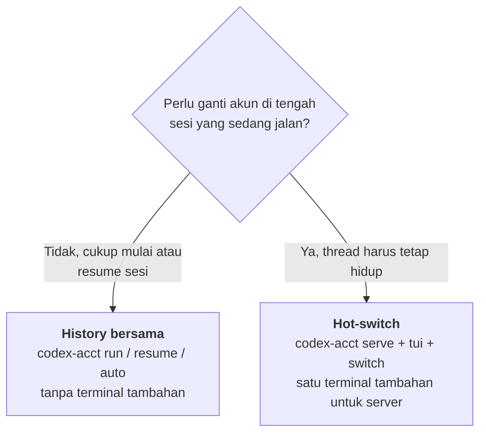
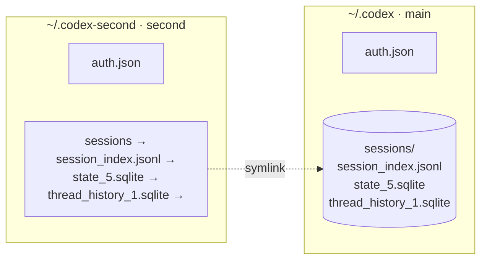
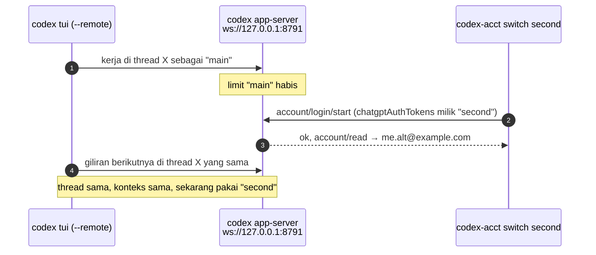

<div align="center">

# codex-acct

**Jalankan beberapa akun [Codex CLI](https://github.com/openai/codex) dengan satu history yang sama.**<br>
Saat limit satu akun habis, lanjut pakai akun berikutnya tanpa logout, login ulang, atau kehilangan percakapan.

[](https://github.com/Syauqi-N/codex-acct/actions/workflows/ci.yml)
[](LICENSE)

-5fa04e?logo=nodedotjs&logoColor=white)


[English](README.md) · **Bahasa Indonesia**



[Mulai cepat](#mulai-cepat) · [Pilih mode](#pilih-mode) · [Perintah](#perintah) · [Cara kerja](#cara-kerja) · [Troubleshooting](#troubleshooting) · [FAQ](#faq)

</div>

---

## Kenapa

Codex CLI cuma menyimpan **satu** login per `CODEX_HOME` (`~/.codex/auth.json`). Kalau kuota akun habis di tengah kerjaan, pilihannya `codex logout` lalu `codex login` pakai akun lain setiap kali, atau bikin `CODEX_HOME` kedua yang membuat sesi kamu terpecah di dua tempat.

`codex-acct` memberi tiap akun home sendiri tapi **satu history bersama**:

- 🔁 **Resume dari mana saja.** Sesi yang dimulai di akun A bisa dilanjutkan di akun B dengan `codex-acct resume <id>`.
- ⚡ **Hot-switch.** Ganti akun di sesi TUI yang *sedang jalan* tanpa restart. Thread-nya tetap hidup.
- 🤖 **Pilih otomatis.** `codex-acct auto` mengecek pemakaian semua akun dan memakai akun pertama yang kuotanya masih ada.
- 📦 **Tanpa dependency tambahan.** Satu script Python plus bridge Node kecil. Tidak perlu install apa pun dari pip atau npm.

## Mulai cepat

```bash
# 1. install (symlink ke ~/.local/bin)
git clone https://github.com/Syauqi-N/codex-acct.git
cd codex-acct
./install.sh

# 2. login yang sudah ada di ~/.codex otomatis jadi akun "main".
#    daftarkan akun kedua (browser akan terbuka untuk login)
codex-acct add second

# 3. satukan history kedua akun (sekali saja, saat Codex tertutup)
codex-acct share

# 4. cek kedua akun
codex-acct list
```

```text
   ACCOUNT      EMAIL                          PLAN    USAGE      HOME
*  main         me@example.com                 plus    LIMIT      /home/me/.codex
   second       me.alt@example.com             plus    12% used   /home/me/.codex-second
```

<details>
<summary><b>Kebutuhan</b></summary>

| Butuh | Untuk |
|---|---|
| [Codex CLI](https://github.com/openai/codex) (`npm i -g @openai/codex`) | semuanya. Diuji dengan `codex-cli 0.167.0` |
| Python 3.9+ (stdlib saja) | semuanya |
| Node 22+ (`WebSocket` bawaan) | hanya hot-switch: `serve`, `tui`, `switch`, `status` |
| Linux atau macOS | `share` memakai symlink dan mengecek proses dengan `ps` |

Install ke lokasi selain `~/.local/bin` dengan `BIN_DIR=/usr/local/bin ./install.sh`.

</details>

## Pilih mode



<table>
<tr><th width="50%">🔁 History bersama (tanpa server)</th><th width="50%">⚡ Hot-switch (dengan server)</th></tr>
<tr valign="top"><td>

```bash
# kerja pakai akun default
codex-acct run

# limit habis? keluar dari codex, lalu
codex-acct auto            # pilih akun yang kuotanya ada
codex-acct resume <id>     # atau resume di akun pilihan
codex-acct resume --acct second <id>
```

✅ Tanpa terminal tambahan<br>
⚠️ Ganti akun berarti keluar lalu resume sesi<br>
⚠️ Jangan jalankan dua akun bersamaan (database-nya sama)

</td><td>

```bash
# terminal 1: server
codex-acct serve

# terminal 2: TUI yang terhubung ke server
codex-acct tui

# terminal 3: kapan pun limit habis
codex-acct auto            # atau: codex-acct switch second
```

✅ TUI tidak pernah restart, konteks thread tetap utuh<br>
⚠️ Butuh terminal tambahan untuk server<br>
⚠️ Kalau server berhenti, TUI ikut terputus

</td></tr>
</table>

## Perintah

| Perintah | Fungsi |
|---|---|
| `codex-acct add <nama>` | Daftarkan akun di `~/.codex-<nama>` dan buka browser untuk login |
| `codex-acct list` (`ls`) | Daftar akun dengan email, plan, dan pemakaian. `*` menandai default |
| `codex-acct use <nama>` | Set akun default |
| `codex-acct share` | Satukan history semua akun ke `~/.codex` lalu link balik. Aman dijalankan ulang |
| `codex-acct run [--acct <nama>] [args]` | Jalankan `codex [args]` dengan akun default (atau akun tertentu) |
| `codex-acct resume [--acct <nama>] [id]` | Resume sesi, dari akun mana pun sesi itu dibuat |
| `codex-acct auto [args]` | Pakai akun pertama yang kuotanya ada. Hot-switch kalau server jalan, kalau tidak jalankan `codex [args]` |
| `codex-acct serve [--port N] [nama]` | Jalankan app-server websocket di `ws://127.0.0.1:8791` |
| `codex-acct tui [args]` | Buka TUI Codex yang terhubung ke server itu |
| `codex-acct switch <nama>` (`sw`) | Hot-switch server ke akun lain |
| `codex-acct status` | Tampilkan akun, plan, dan pemakaian yang aktif di server |

<details>
<summary><b>Contoh</b></summary>

```bash
# flag codex apa pun diteruskan lewat run / auto / tui
codex-acct run --acct second -C ~/projects/app
codex-acct auto exec "tulis changelog"

# buka pemilih sesi di akun tertentu
codex-acct resume --acct second

# jalankan server di port lain, mulai dengan akun "second"
codex-acct serve --port 9000 second

# jadikan "second" default untuk run/resume/serve
codex-acct use second
```

</details>

<details>
<summary><b>File yang ditulis codex-acct</b></summary>

| Path | Isi |
|---|---|
| `~/.codex/accounts.json` | Nama akun, home masing-masing, dan default |
| `~/.codex/acct-state.json` | URL dan PID server yang dijalankan `serve` |
| `~/.codex/acct-ws-token` | Token acak pelindung server (mode `600`) |
| `~/.codex-<nama>/` | Home tiap akun tambahan (`auth.json`, config sendiri, log...) |

</details>

## Cara kerja

### History bersama

Tiap akun adalah `CODEX_HOME` terpisah dengan `auth.json` sendiri. `share` memindahkan history setiap akun tambahan ke `~/.codex` dan menggantinya dengan symlink, jadi semua akun membaca dan menulis sesi yang sama.



<details>
<summary><b>Apa yang dilakukan <code>share</code> ke data kamu</b></summary>

`share` tidak pernah menimpa isi `~/.codex`. Untuk setiap item di setiap akun tambahan:

| Item | Kalau `~/.codex` belum punya | Kalau dua-duanya punya |
|---|---|---|
| `sessions/` | dipindah | file digabung; file yang ada di kedua sisi disimpan di `~/.codex-<nama>/sessions.unmerged-<waktu>/` |
| `session_index.jsonl` | dipindah | baris yang belum ada ditambahkan |
| `state_5.sqlite`, `thread_history_1.sqlite` | disalin dengan SQLite backup API (baris yang masih di file `-wal` ikut) | baris ditambah dengan `INSERT OR IGNORE`; kalau gagal, database dibiarkan utuh dan tidak di-share |

Item yang belum dimiliki akun tetap di-link, jadi akun yang baru ditambahkan langsung menulis ke history bersama sejak sesi pertamanya.

`share` menolak jalan selama masih ada proses `codex`, karena file-file itu sedang terbuka.

**Tidak di-share:** `auth.json`, `config.toml` (disalin sekali oleh `add`), `history.jsonl` (riwayat prompt), log, memories, dan goals.

</details>

### Hot-switch

`serve` menjalankan `codex app-server` di websocket lokal yang dilindungi token acak. `tui` menghubungkan TUI Codex biasa ke server itu dengan `codex --remote`. `switch` membaca token akun lain dari `auth.json`-nya lalu menyerahkannya ke server yang sedang jalan:



> [!WARNING]
> Hot-switch bergantung pada `account/login/start` tipe `chatgptAuthTokens`, yang ditandai **unstable dan internal** di schema protokol Codex sendiri. Berjalan di `codex-cli 0.167.0`, tapi bisa rusak di rilis mana pun. Mode history bersama tidak bergantung pada API ini.

## Troubleshooting

<details>
<summary><code>error: lost connection to ws://127.0.0.1:8791 ...</code></summary>

Server tidak jalan. Jalankan `codex-acct serve` di terminal lain.

</details>

<details>
<summary><code>no rollout found for thread id ...</code></summary>

Sesinya ada di history akun lain yang belum di-share. Tutup Codex lalu jalankan `codex-acct share`.

</details>

<details>
<summary><code>share</code> bilang "Codex is still running"</summary>

Tutup semua TUI atau `exec` Codex. Codex juga bisa menjalankan daemon app-server di background untuk tiap home. Hentikan dengan:

```bash
CODEX_HOME=~/.codex codex app-server daemon stop
CODEX_HOME=~/.codex-second codex app-server daemon stop
```

</details>

<details>
<summary><code>modelProviderNotConfigured</code> saat resume</summary>

Sesi dibuat dengan model provider custom yang sudah tidak ada di `config.toml` akun itu. Tambahkan lagi provider-nya (tiap akun punya config sendiri) atau mulai sesi baru.

</details>

<details>
<summary><code>This chat uses openai, but your current provider is ...</code></summary>

Sesi dibuat dengan `model_provider` yang berbeda. Samakan `model_provider` di `config.toml` kedua akun.

</details>

<details>
<summary><code>codex-acct needs Node 22+</code></summary>

Bridge hot-switch memakai `WebSocket` bawaan Node yang tersedia mulai Node 22. Mode history bersama jalan tanpa Node.

</details>

<details>
<summary>Akun hasil switch berhenti bekerja setelah sesi yang lama</summary>

`switch` menyerahkan access token yang sedang tersimpan di `auth.json` akun itu, dan server tidak bisa me-refresh token itu sendiri. Jalankan `codex-acct switch <nama>` lagi. Kalau token yang tersimpan sendiri sudah lama, buka akun itu sekali dengan `codex-acct run --acct <nama>` supaya Codex me-refresh-nya, lalu switch.

</details>

## FAQ

<details>
<summary><b>Apakah percakapan benar-benar tetap utuh setelah switch?</b></summary>

Ya. Di mode hot-switch, thread tidak pernah keluar dari server. Di mode history bersama, file sesinya adalah file yang sama, hanya dibaca oleh akun lain. Blob reasoning terenkripsi (`reasoning.encrypted_content`) terikat ke akun pembuatnya; akun lain mengabaikannya dan isi percakapan yang terlihat tetap utuh.

</details>

<details>
<summary><b>Bisa pakai akun API key?</b></summary>

`add` memakai login browser ChatGPT. `run`, `resume`, `auto`, dan `share` hanya mengatur `CODEX_HOME`, jadi jalan dengan login apa pun yang ada di home itu. Hot-switch (`switch`) butuh login ChatGPT, karena yang diserahkan adalah token ChatGPT.

</details>

<details>
<summary><b>Bagaimana cara menghapus akun?</b></summary>

Hapus entrinya dari `~/.codex/accounts.json`, lalu hapus `~/.codex-<nama>`. Kalau kamu sudah menjalankan `share`, history-nya sudah ada di `~/.codex`, jadi tidak ada sesi yang hilang.

</details>

<details>
<summary><b>Bagaimana cara uninstall?</b></summary>

```bash
rm ~/.local/bin/codex-acct ~/.local/bin/codex-acct-ws.js
rm ~/.codex/accounts.json ~/.codex/acct-state.json ~/.codex/acct-ws-token
```

Home akun tambahan (`~/.codex-<nama>`) silakan dihapus sendiri.

</details>

<details>
<summary><b>Apakah ini terafiliasi dengan OpenAI?</b></summary>

Tidak. Ini tool tidak resmi yang menjalankan Codex CLI yang sudah kamu install. Pastikan cara kamu memakai banyak akun sesuai dengan ketentuan OpenAI.

</details>

## Development

```bash
python3 -m unittest discover -v tests   # unit test, tidak butuh Codex
node --check codex-acct-ws.js
```

Projek ini terdiri dari tiga file: `codex-acct` (Python, seluruh CLI), `codex-acct-ws.js` (bridge stdio ↔ websocket, karena stdlib Python tidak punya klien websocket), dan `install.sh`. Issue dan pull request dipersilakan.

## Lisensi

[MIT](LICENSE)
