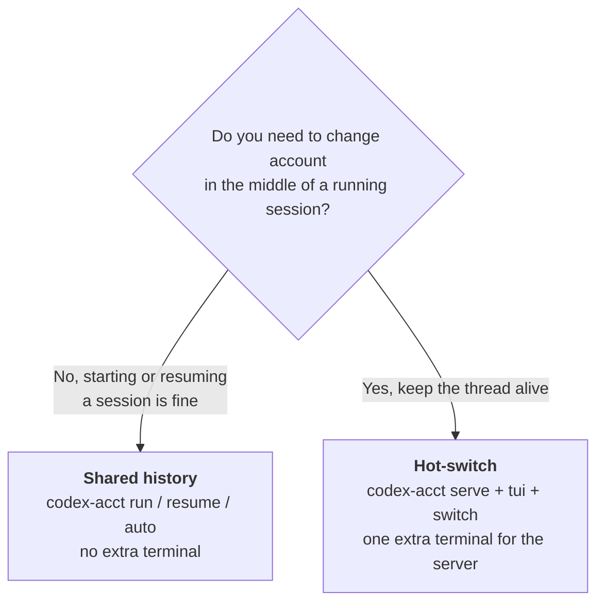
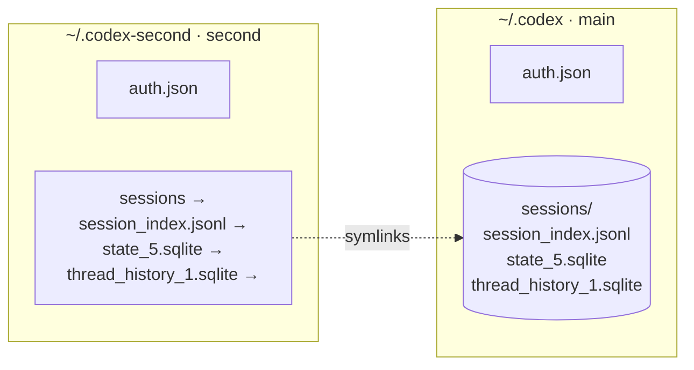
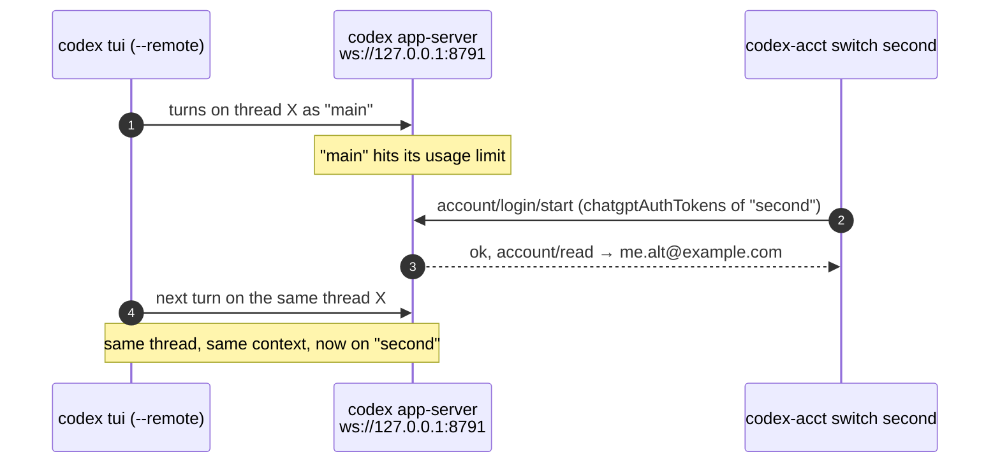

<div align="center">

# codex-acct

**Run several [Codex CLI](https://github.com/openai/codex) accounts on one shared history.**<br>
When one account hits its usage limit, keep going on the next one without logging out, logging back in, or losing the conversation.

[](https://github.com/Syauqi-N/codex-acct/actions/workflows/ci.yml)
[](LICENSE)

-5fa04e?logo=nodedotjs&logoColor=white)


**English** · [Bahasa Indonesia](README.id.md)



[Quick start](#quick-start) · [Pick a mode](#pick-a-mode) · [Commands](#commands) · [How it works](#how-it-works) · [Troubleshooting](#troubleshooting) · [FAQ](#faq)

</div>

---

## Why

Codex CLI keeps **one** login per `CODEX_HOME` (`~/.codex/auth.json`). If your account runs out of quota halfway through a task, you either `codex logout` and `codex login` with another account every time, or keep a second `CODEX_HOME`, which splits your sessions across two places.

`codex-acct` gives each account its own home but **one shared history**:

- 🔁 **Resume anywhere.** A session started on account A can be resumed on account B with `codex-acct resume <id>`.
- ⚡ **Hot-switch.** Change the account of a *running* TUI session without restarting it. The thread stays alive.
- 🤖 **Auto-pick.** `codex-acct auto` checks every account's usage and uses the first one with quota left.
- 📦 **No dependencies to install.** One Python script plus a tiny Node bridge. Nothing from pip or npm.

## Quick start

```bash
# 1. install (symlinks into ~/.local/bin)
git clone https://github.com/Syauqi-N/codex-acct.git
cd codex-acct
./install.sh

# 2. your existing ~/.codex login becomes the account "main".
#    register a second account (opens the browser to log in)
codex-acct add second

# 3. merge both histories into one (run once, with Codex closed)
codex-acct share

# 4. check both accounts
codex-acct list
```

```text
   ACCOUNT      EMAIL                          PLAN    USAGE      HOME
*  main         me@example.com                 plus    LIMIT      /home/me/.codex
   second       me.alt@example.com             plus    12% used   /home/me/.codex-second
```

<details>
<summary><b>Requirements</b></summary>

| Need | For |
|---|---|
| [Codex CLI](https://github.com/openai/codex) (`npm i -g @openai/codex`) | everything. Tested with `codex-cli 0.167.0` |
| Python 3.9+ (stdlib only) | everything |
| Node 22+ (built-in `WebSocket`) | hot-switch only: `serve`, `tui`, `switch`, `status` |
| Linux or macOS | `share` uses symlinks, `share` checks running processes with `ps` |

Install somewhere other than `~/.local/bin` with `BIN_DIR=/usr/local/bin ./install.sh`.

</details>

## Pick a mode



<table>
<tr><th width="50%">🔁 Shared history (no server)</th><th width="50%">⚡ Hot-switch (with server)</th></tr>
<tr valign="top"><td>

```bash
# work on the default account
codex-acct run

# limit hit? quit codex, then
codex-acct auto            # picks an account with quota
codex-acct resume <id>     # or resume on a chosen one
codex-acct resume --acct second <id>
```

✅ No extra terminal<br>
⚠️ Switching means quitting and resuming the session<br>
⚠️ Don't run two accounts at the same time (they share one database)

</td><td>

```bash
# terminal 1: the server
codex-acct serve

# terminal 2: your TUI, attached to it
codex-acct tui

# terminal 3: whenever the limit hits
codex-acct auto            # or: codex-acct switch second
```

✅ The TUI never restarts, the thread keeps its context<br>
⚠️ Needs an extra terminal for the server<br>
⚠️ If the server stops, the TUI disconnects

</td></tr>
</table>

## Commands

| Command | What it does |
|---|---|
| `codex-acct add <name>` | Register an account in `~/.codex-<name>` and open the browser to log in |
| `codex-acct list` (`ls`) | List accounts with email, plan and usage. `*` marks the default |
| `codex-acct use <name>` | Set the default account |
| `codex-acct share` | Merge every account's history into `~/.codex` and link it back. Safe to run again |
| `codex-acct run [--acct <name>] [args]` | Run `codex [args]` with the default (or given) account |
| `codex-acct resume [--acct <name>] [id]` | Resume a session, whichever account created it |
| `codex-acct auto [args]` | Use the first account with quota left. Hot-switches if a server is running, otherwise starts `codex [args]` |
| `codex-acct serve [--port N] [name]` | Start a websocket app-server on `ws://127.0.0.1:8791` |
| `codex-acct tui [args]` | Open the Codex TUI attached to that server |
| `codex-acct switch <name>` (`sw`) | Hot-switch the server to another account |
| `codex-acct status` | Show the account, plan and usage active on the server |

<details>
<summary><b>Examples</b></summary>

```bash
# pass any codex flags through run / auto / tui
codex-acct run --acct second -C ~/projects/app
codex-acct auto exec "write the changelog"

# open the session picker on a specific account
codex-acct resume --acct second

# run the server on another port, starting as "second"
codex-acct serve --port 9000 second

# make "second" the default for run/resume/serve
codex-acct use second
```

</details>

<details>
<summary><b>Files codex-acct writes</b></summary>

| Path | Content |
|---|---|
| `~/.codex/accounts.json` | Account names, their homes, and the default |
| `~/.codex/acct-state.json` | URL and PID of the server started by `serve` |
| `~/.codex/acct-ws-token` | Random token that protects the server (mode `600`) |
| `~/.codex-<name>/` | Home of each extra account (`auth.json`, its own config, logs...) |

</details>

## How it works

### Shared history

Each account is a separate `CODEX_HOME` with its own `auth.json`. `share` moves the history of every extra account into `~/.codex` and replaces it with symlinks, so every account reads and writes the same sessions.



<details>
<summary><b>What <code>share</code> does to your data</b></summary>

`share` never overwrites what is already in `~/.codex`. For each item in each extra account:

| Item | If `~/.codex` has none | If both have one |
|---|---|---|
| `sessions/` | moved over | files merged; a file that exists on both sides is kept in `~/.codex-<name>/sessions.unmerged-<time>/` |
| `session_index.jsonl` | moved over | missing lines appended |
| `state_5.sqlite`, `thread_history_1.sqlite` | copied with the SQLite backup API (keeps rows still in the `-wal` file) | rows added with `INSERT OR IGNORE`; if the merge fails the database is left untouched and unshared |

Items the account doesn't have yet are linked anyway, so a freshly added account writes to the shared history from its first session.

It refuses to run while any `codex` process is running, because those files are open.

**Not shared:** `auth.json`, `config.toml` (copied once by `add`), `history.jsonl` (prompt history), logs, memories and goals.

</details>

### Hot-switch

`serve` runs `codex app-server` on a local websocket, protected by a random token. `tui` attaches the normal Codex TUI to it with `codex --remote`. `switch` reads the other account's tokens from its `auth.json` and hands them to the running server:



> [!WARNING]
> Hot-switch relies on `account/login/start` with type `chatgptAuthTokens`, which Codex's own protocol schema marks as **unstable and internal**. It works with `codex-cli 0.167.0` but can break in any release. Shared-history mode doesn't depend on it.

## Troubleshooting

<details>
<summary><code>error: lost connection to ws://127.0.0.1:8791 ...</code></summary>

The server isn't running. Start it with `codex-acct serve` in another terminal.

</details>

<details>
<summary><code>no rollout found for thread id ...</code></summary>

The session lives in another account's history that hasn't been shared yet. Close Codex and run `codex-acct share`.

</details>

<details>
<summary><code>share</code> says "Codex is still running"</summary>

Quit every Codex TUI or `exec`. Codex can also keep a background app-server daemon per home. Stop it with:

```bash
CODEX_HOME=~/.codex codex app-server daemon stop
CODEX_HOME=~/.codex-second codex app-server daemon stop
```

</details>

<details>
<summary><code>modelProviderNotConfigured</code> when resuming</summary>

The session was created with a custom model provider that is no longer in that account's `config.toml`. Add the provider back (each account has its own config) or start a new session.

</details>

<details>
<summary><code>This chat uses openai, but your current provider is ...</code></summary>

The session was created with a different `model_provider`. Use the same `model_provider` in the `config.toml` of both accounts.

</details>

<details>
<summary><code>codex-acct needs Node 22+</code></summary>

The hot-switch bridge uses Node's built-in `WebSocket`, available from Node 22. Shared-history mode works without Node.

</details>

<details>
<summary>The switched account stops working after a long session</summary>

`switch` hands over the access token currently stored in that account's `auth.json`, and the server can't refresh it on its own. Run `codex-acct switch <name>` again. If the stored token itself is old, open the account once with `codex-acct run --acct <name>` so Codex refreshes it, then switch.

</details>

## FAQ

<details>
<summary><b>Does the conversation really survive a switch?</b></summary>

Yes. In hot-switch mode the thread never leaves the server. In shared-history mode the session file is the same file, read by another account. Encrypted reasoning blobs (`reasoning.encrypted_content`) are tied to the account that created them; another account ignores them and the visible conversation stays intact.

</details>

<details>
<summary><b>Can I use an API key account?</b></summary>

`add` uses the ChatGPT browser login. `run`, `resume`, `auto` and `share` only set `CODEX_HOME`, so they work with whatever login a home has. Hot-switch (`switch`) needs a ChatGPT login, because it hands over ChatGPT tokens.

</details>

<details>
<summary><b>How do I remove an account?</b></summary>

Delete its entry from `~/.codex/accounts.json`, then delete `~/.codex-<name>`. If you ran `share`, its history already lives in `~/.codex`, so no session is lost.

</details>

<details>
<summary><b>How do I uninstall?</b></summary>

```bash
rm ~/.local/bin/codex-acct ~/.local/bin/codex-acct-ws.js
rm ~/.codex/accounts.json ~/.codex/acct-state.json ~/.codex/acct-ws-token
```

Extra account homes (`~/.codex-<name>`) are left for you to delete.

</details>

<details>
<summary><b>Is this affiliated with OpenAI?</b></summary>

No. It is an unofficial tool that drives the Codex CLI you already have installed. Make sure the way you use multiple accounts complies with OpenAI's terms.

</details>

## Development

```bash
python3 -m unittest discover -v tests   # unit tests, no Codex needed
node --check codex-acct-ws.js
```

The project is three files: `codex-acct` (Python, the whole CLI), `codex-acct-ws.js` (stdio ↔ websocket bridge, because Python's stdlib has no websocket client) and `install.sh`. Issues and pull requests are welcome.

## License

[MIT](LICENSE)
